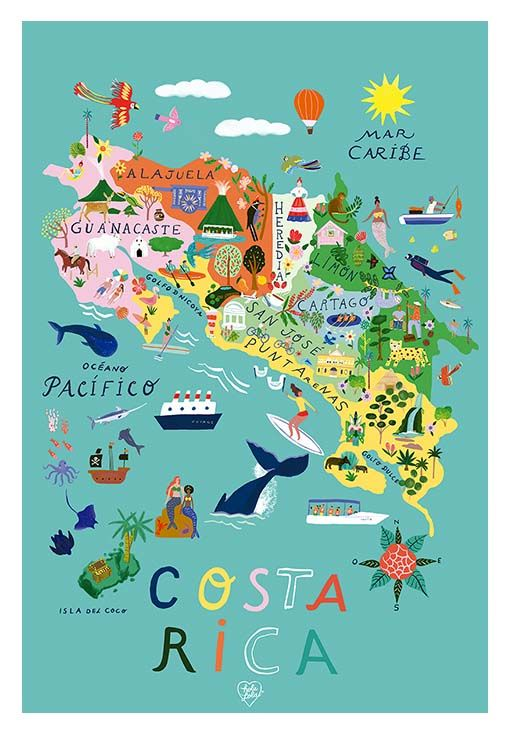
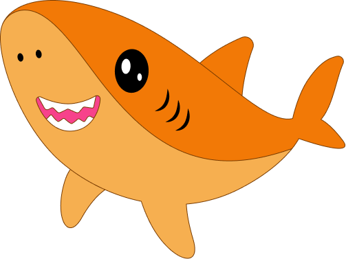
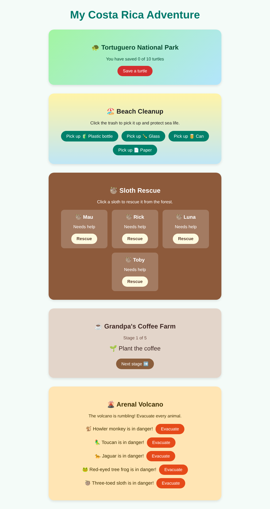

## Welcome to Costa Rica!

You just won a trip to **Costa Rica**! 🎉 It's a small country in Central America with beaches on two coasts: the Pacific Ocean and the Caribbean Sea. It also has volcanoes, rainforests and amazing animals.

Your guide is **Sharky**, a very unusual shark that fishermen found in the waters of Costa Rica. Can you believe it? An **orange** shark!

## What you'll build

On this trip you'll build a real web app with **React**. React is a JavaScript tool for building websites. It was made at Facebook, and websites like Facebook and Instagram use it.

Each stop on your trip is one card in your app:

| Stop | What you do | What you learn |
|---|---|---|
| 🐢 Tortuguero | Save 10 sea turtles | State and clicks |
| 🏖️ The beach | Pick up the trash | Lists |
| 🦥 The rainforest | Rescue 4 sloths | Components and props |
| ☕ Coffee farm (bonus) | Follow coffee from the plant to the cup | Moving through steps |
| 🌋 Arenal volcano (bonus) | Get the animals to safety | Practice everything |

When you finish, your app will look like this:

## Before you start

- ⏱️ **Time:** about 75 minutes. The bonus activities are extra.
- 🎒 **Who:** ages 10 and up. You don't need to know React.
- 💻 **What you need:** a computer with the Chrome, Edge or Firefox web browser. You don't need an account, and there's nothing to install. A tablet or phone won't work well, because you'll type code.

## How it works

You start with an app that already runs. Its files have numbered **TODO** notes that show where your code goes. Each activity tells you which file to open, what to type, and what you should see. If you get lost, every activity ends with the complete file so you can catch up.

**Ready? Start here: [Get your starter project](get-started/)**

## Contents

Sections

{}

