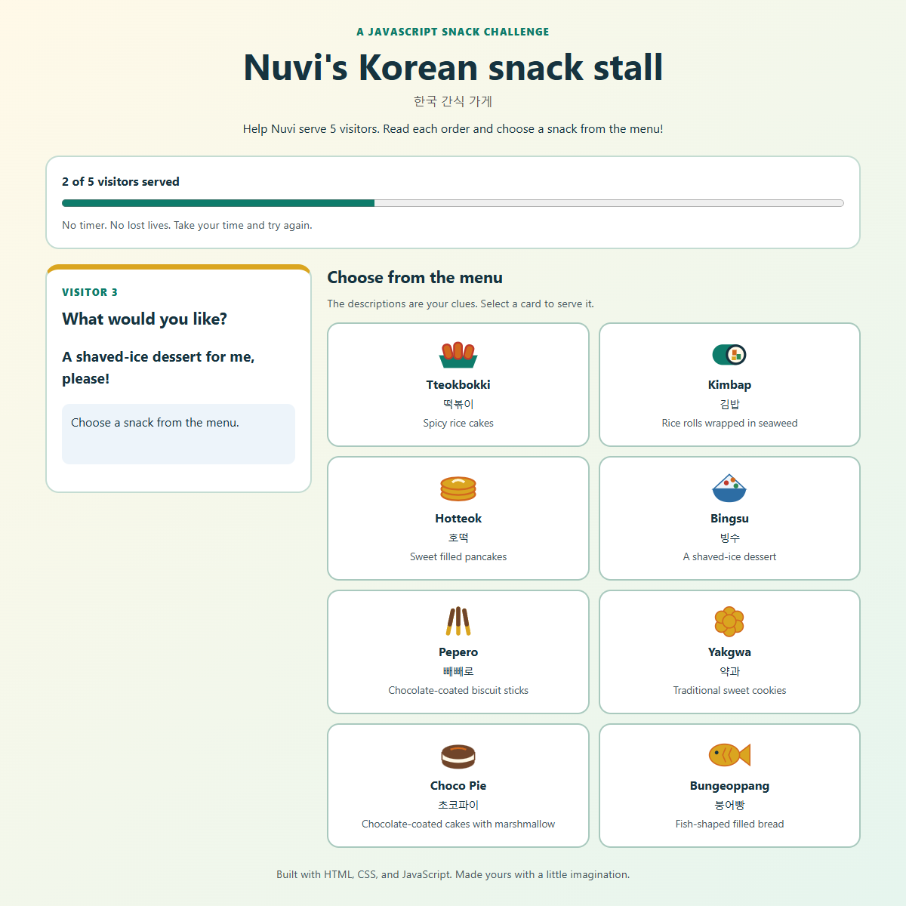

## Help Nuvi open a snack stall

Nuvi is visiting Seoul and wants to run a Korean snack stall. The menu is ready, but Nuvi needs your help taking orders!

Your mission is to build a game where a player reads a visitor's order, chooses the matching snack, and serves **five visitors**. An incorrect choice gives a hint and another try. When all five visitors are served, it's time to celebrate!

## What you'll build

The four activities unlock the game one piece at a time:

| Activity | Your mission |
|---|---|
| 1. Open your snack stall | Open the visual starter and make the stall your own. |
| 2. Welcome a visitor | Use JavaScript to choose an order from a list. |
| 3. Match the order | Check the player's choice and give helpful feedback. |
| 4. Serve five visitors | Track progress, celebrate a win, and play again. |

There is **no timer and no penalty for trying again**. Players can read the descriptions on the menu, so they do not need to know the snacks beforehand.

## What you'll learn

- How **HTML** describes a page, **CSS** styles it, and **JavaScript** makes it respond.
- How an **array** stores a list and `Math.random()` helps choose an item.
- How an **`if` statement** checks a player's choice.
- How **variables** track progress and decide when a game is complete.

## What you need

A computer, a web browser, and a plain-text editor. Use an editor you already have, such as VS Code or Notepad. Download and extract the starter in Activity 1. After that, the game runs locally without an account, a server, or an internet connection.

The HTML, CSS, snack list, and page helpers are provided. You will focus on the game rules rather than copy a long stylesheet.

{}
This is your stall! Change its name and colors, then try adding a favorite snack from your own culture in the extra challenge.
{}

## Activities

Open the activity list

{}

