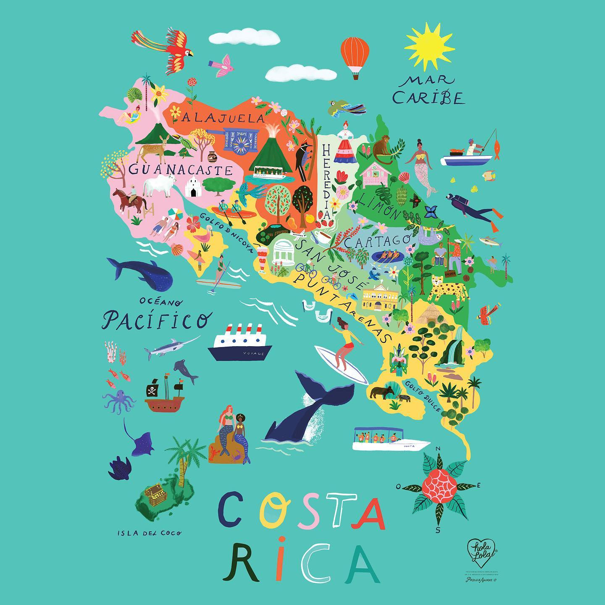
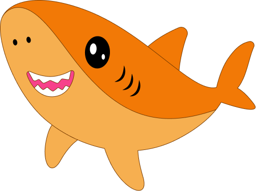
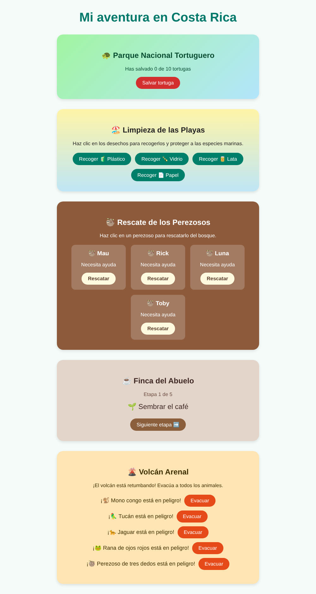

## ¡Bienvenidos a Costa Rica!

¡Te acabas de ganar un viaje a **Costa Rica**! 🎉 Es un país pequeño de Centroamérica con playas en dos costas: la del océano Pacífico y la del mar Caribe. También tiene volcanes, bosques tropicales y animales increíbles.

Tu guía es **Sharky**, un tiburón muy raro que unos pescadores encontraron en las aguas de Costa Rica. ¿Puedes creerlo? ¡Un tiburón **anaranjado**!

## Lo que vas a construir

En este viaje vas a construir una app web de verdad con **React**. React es una herramienta de JavaScript para crear sitios web. La crearon en Facebook, y sitios como Facebook e Instagram la usan.

Cada parada de tu viaje es una tarjeta en tu app:

| Parada | Qué haces | Qué aprendes |
|---|---|---|
| 🐢 Tortuguero | Salvas 10 tortugas marinas | El estado y los clics |
| 🏖️ La playa | Recoges los desechos | Las listas |
| 🦥 El bosque tropical | Rescatas 4 perezosos | Componentes y props |
| ☕ Finca de café (extra) | Sigues el café desde la planta hasta la taza | Avanzar paso a paso |
| 🌋 Volcán Arenal (extra) | Pones a salvo a los animales | Practicar todo lo anterior |

Cuando termines, tu app se verá así:

## Antes de empezar

- ⏱️ **Tiempo:** unos 75 minutos. Las actividades extra son aparte.
- 🎒 **Para quién:** de 10 años en adelante. No necesitas saber React.
- 💻 **Qué necesitas:** una computadora con el navegador Chrome, Edge o Firefox. No necesitas una cuenta y no hay nada que instalar. Una tablet o un celular no funcionan bien, porque vas a escribir código.

## Cómo funciona

Empiezas con una app que ya funciona. Sus archivos tienen notas numeradas que dicen **TAREA** y que te muestran dónde va tu código. Cada actividad te dice qué archivo abrir, qué escribir y qué deberías ver. Si te pierdes, cada actividad termina con el archivo completo para que te pongas al día.

**¿Todo listo? Empieza aquí: [Abre tu proyecto inicial](get-started/)**

## Contenido

Secciones

{}

